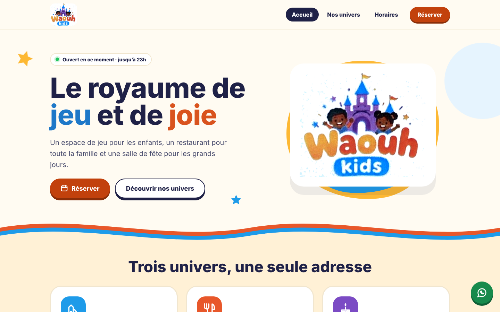
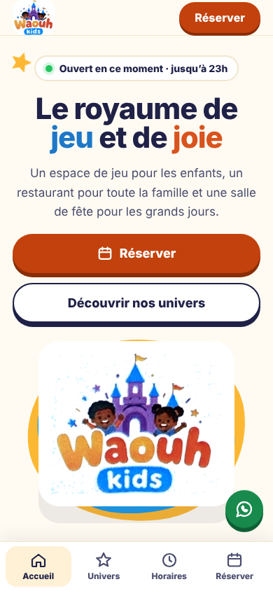
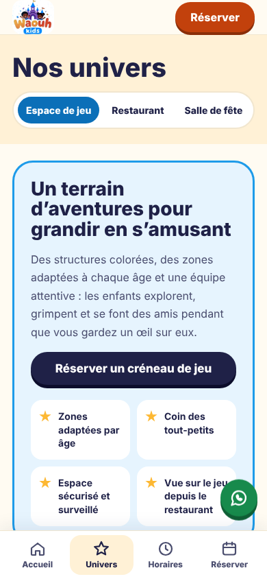
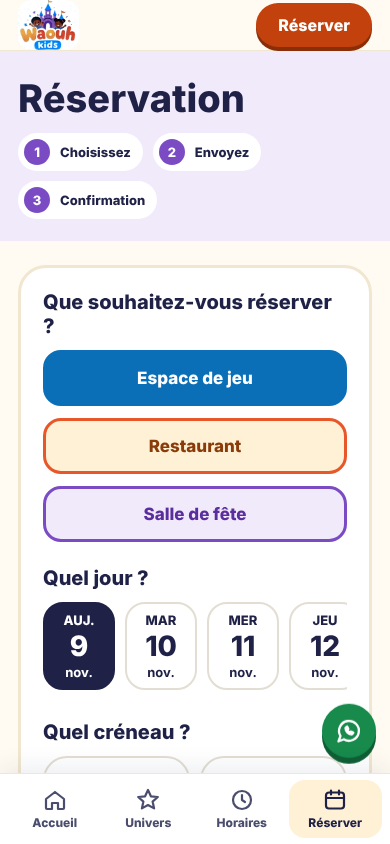

# Waouh Kids — Le royaume de jeu et de joie

Site de **Waouh Kids** (Cotonou, Bénin) : espace de jeu pour enfants, restaurant et salle de fête, ouvert 7j/7 de 8h à 23h, avec réservation en ligne.

Conception : **SIP — Solutions of Intelligence for Projects**



| Accueil | Nos univers | Réservation |
|---|---|---|
|  |  |  |

## Organisation du site

La navigation se fait par onglets. Chaque onglet a sa propre adresse, donc on peut partager un lien direct et le bouton retour du navigateur fonctionne.

| Onglet | Adresse | Contenu |
|---|---|---|
| Accueil | `#accueil` | Présentation courte, accès aux 3 univers, Nous trouver |
| Nos univers | `#univers-jeu`, `#univers-resto`, `#univers-fete` | Espace de jeu, Restaurant, Salle de fête (avec les formules anniversaire) |
| Horaires | `#horaires` | Horaires de la semaine, jour actuel mis en évidence, statut ouvert ou fermé |
| Réservation | `#reservation` (ou `#reservation-fete`…) | Formulaire de réservation, avec l’univers présélectionné quand on vient d’un univers |

Sur mobile, les onglets s’affichent dans une barre en bas de l’écran, comme dans une application.

## Alertes WhatsApp et e-mail automatiques

Le formulaire envoie la réservation, au format JSON, à l’adresse `webhookUrl` indiquée dans `script.js`. Un scénario d’automatisation (Make, n8n ou Zapier) envoie ensuite automatiquement :
- la confirmation au client, sur WhatsApp et par e-mail ;
- l’alerte de nouvelle réservation à l’équipe Waouh Kids.

Si `webhookUrl` est vide, le site fonctionne en **mode démonstration** : l’écran de confirmation s’affiche, mais rien n’est envoyé.

Exemple de données envoyées :

```json
{ "univers": "Salle de fête", "date": "2026-11-14", "date_texte": "Samedi 14 nov.",
  "creneau": "Après-midi · 14h – 18h", "enfants": 12, "adultes": 4,
  "nom": "Aïcha Dossou", "whatsapp": "+229 01 00 00 00 00", "email": "aicha@exemple.com" }
```

## À personnaliser

1. Dans `script.js`, objet `CONFIG` : le numéro WhatsApp (`229XXXXXXXXXX`) et `webhookUrl`.
2. Dans `index.html`, les champs à remplir : `[PRIX]`, `[NB]`, `[DURÉE]`, `[ADRESSE]`, `[TÉLÉPHONE]`, `[E-MAIL]`, les photos et la carte Google Maps.
3. Remplacer `assets/logo.png` par le logo original en haute définition.

## Mise en ligne avec GitHub Pages

1. Créer un dépôt, par exemple `waouh-kids`, et y déposer tous les fichiers de ce dossier.
2. Aller dans **Settings → Pages**, choisir **Deploy from a branch**, puis la branche `main` et le dossier `/ (root)`, et cliquer sur **Save**.
3. Le site est en ligne à l’adresse `https://<votre-compte>.github.io/waouh-kids/`.
